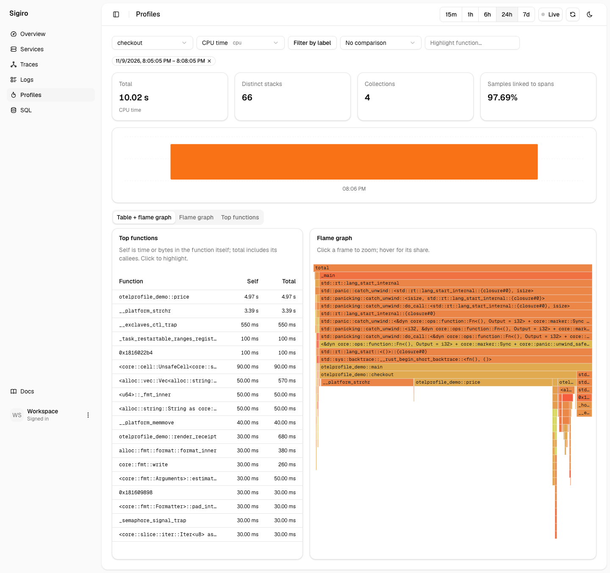
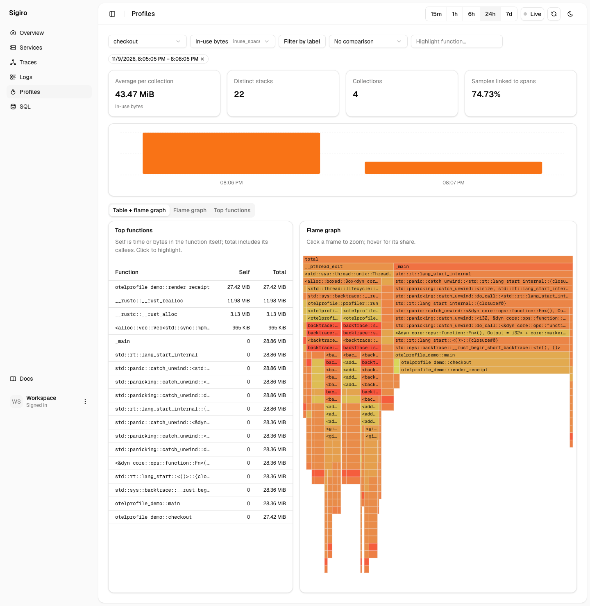
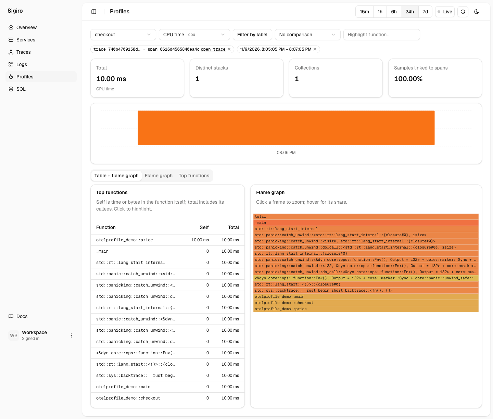

# otelprofile

In-process CPU and heap profiles for Rust. Standard OTLP Profiles, with links back to the spans that produced them. No eBPF, sidecar, or proprietary profile format.

**Experimental.** Not published to crates.io. The OTLP Profiles development protocol and this API can change.



## Start

```sh
cargo add otelprofile --git https://github.com/akshatagarwl/otelprofile-rs --features opentelemetry
```

```rust,no_run
#[global_allocator]
static ALLOC: otelprofile::alloc::Sampled<std::alloc::System> =
    otelprofile::alloc::Sampled::new(std::alloc::System);

fn main() -> Result<(), otelprofile::Error> {
    let _profiler = otelprofile::start(otelprofile::Config {
        service_name: "checkout".into(),
        endpoint: "http://localhost:4318".into(),
        ..Default::default()
    })?;
    // Run your application. Keep the guard alive until shutdown.
    Ok(())
}
```

CPU requests 100 Hz. Heap sampling at a mean 512 KiB. Export every 15 seconds over OTLP/HTTP. Already using jemalloc? [Use its built-in profiler instead.](docs/setup.md#jemalloc)

## Find the hot code

Real [checkout demo](examples/demo) profiles in [sigiro](https://github.com/akshatagarwl/sigiro). Screenshots come from the running receiver, not mockups.



## Find retained memory





## Follow a span to its profile

The `opentelemetry` feature observes active OpenTelemetry contexts, including spans bridged through `tracing-opentelemetry`. Export traces separately through your existing SDK.





## Send standard OTLP



| Receiver | Verified readback |
|---|---|
| Collector 0.165.0 | All six kinds, span links |
| sigiro `3c801fb` | All six kinds, links resolve to spans |
| Pyroscope 2.4.3 | CPU + four heap graphs; count graph unavailable |

[Setup and limits](docs/setup.md) · [Receiver verification](docs/receivers.md) · [Measured overhead](docs/benchmarks.md) · [Scorecard](SCORECARD.md) · [Rebuild these assets](docs/assets/src/README.md)

Linux and macOS, x86-64 and ARM64. Keep debug information for useful function names. The macOS Intel runner currently fails absolute CPU-time accuracy; see [timer and unwinder limits](docs/setup.md#known-macos-timer-accuracy-limit).

Rust sibling of [otelprofile-go](https://github.com/akshatagarwl/otelprofile-go). Apache-2.0; [license](LICENSE).
